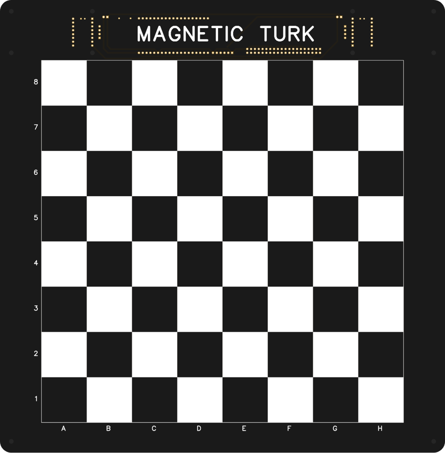
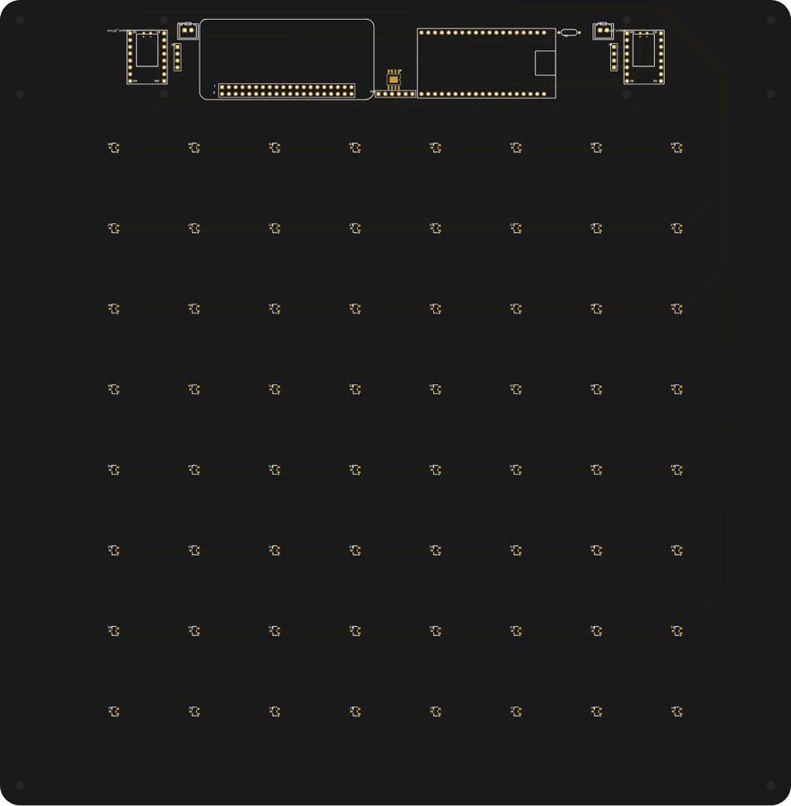
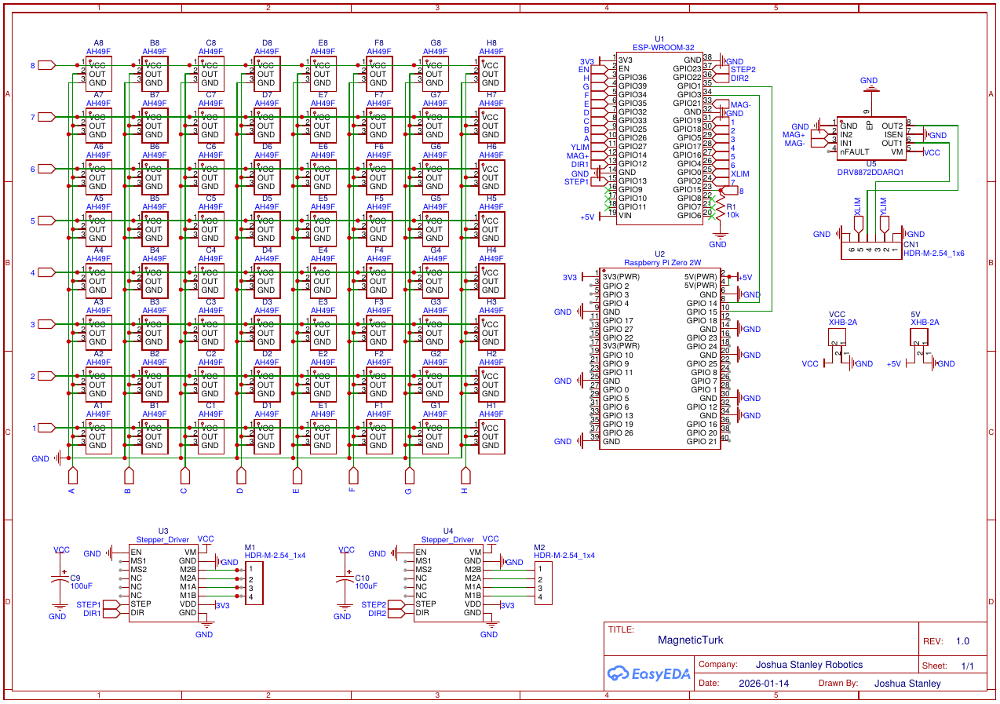

# Version 1: Magnetic Under-Board Design

The first version of MagneticTurk was a self-playing chessboard. An electromagnet on a CoreXY
gantry hidden under the board dragged the pieces across the surface, and a grid of Hall-effect
sensors detected which squares were occupied.

The electronics are **adapted from [ChessBot V1](#credit) by Joshua Stanley Robotics** (MIT License).
The schematic's title block still shows the original author for that reason.

| Top (playing surface) | Bottom (sensors and electronics) |
|---|---|
|  |  |

*Rendered from the Gerber files. Black solder mask, white silkscreen.*

## How it worked

- **Sensing:** 64 × AH49FNTR-G1 Hall-effect sensors, one under each square on a 30 mm grid,
  detect the magnets in the piece bases.
- **Control:** an ESP32 scans the sensor grid and drives the motion system. A Raspberry Pi Zero 2 W
  runs Stockfish and the game logic.
- **Motion:** two NEMA 17 steppers on stepper-driver modules move a CoreXY carriage under the board.
- **Actuation:** a 5 V, 50 N electromagnet on the carriage, switched by a DRV8872 driver, drags the piece.

## Files

| File | Contents |
|---|---|
| [`pcb/schematic.pdf`](pcb/schematic.pdf) | Full schematic |
| [`pcb/gerber.zip`](pcb/gerber.zip) | Manufacturing files: copper, mask, silkscreen, outline, drills |
| [`pcb/bom.csv`](pcb/bom.csv) | Bill of materials with LCSC part numbers |
| [`pcb/pick_and_place.csv`](pcb/pick_and_place.csv) | Component positions for assembly |

Designed in EasyEDA, with assembly ordered from JLCPCB. The frame was modelled in Fusion 360 for 3D printing.

## Why the project moved on

Dragging pieces from below has built-in limits:

- Pieces have to slide between other pieces, so many moves need careful path planning.
- Captures are awkward, because the captured piece must be dragged off the board first.
- The sensors can tell that a square is occupied, but not which piece is on it.

Version 2 replaces all of this with a 6DOF robotic arm that lifts pieces from above, guided by a
wrist-mounted camera. See the [main README](../../README.md) and the
[data sheet](../../docs/datasheet/magneticturk_datasheet.pdf).

## Credit

The circuit design is derived from **ChessBot V1** by Joshua Stanley Robotics, released under the
MIT License.
